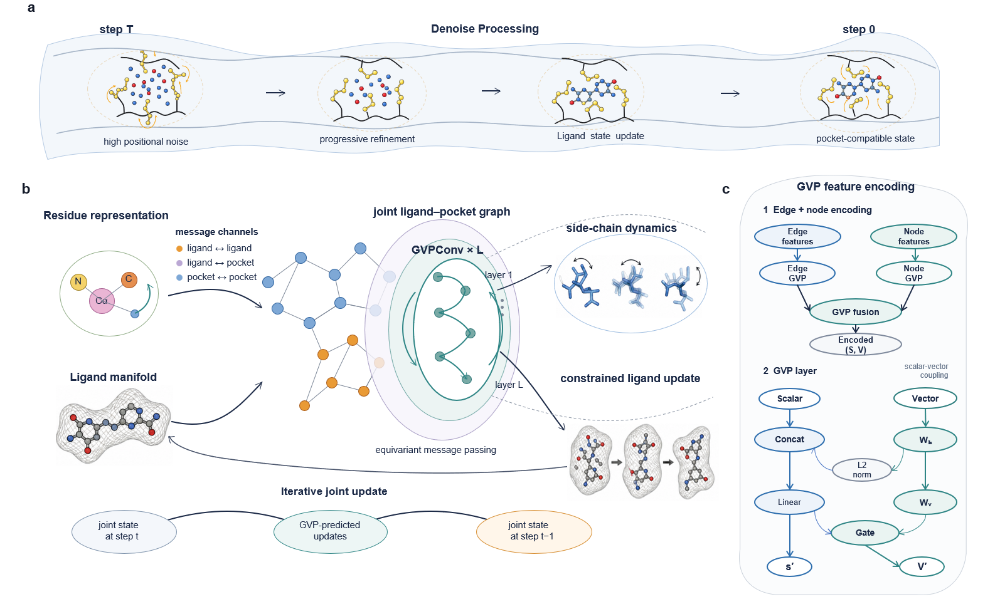

# Geometry-Constrained Ligand Generation with Adaptive Protein Side Chains

This repository provides instructions for setting up the environment, preparing the CrossDocked and PDBbind datasets, training the model, generating ligand samples, and evaluating the results.

<p align="center">
  <br>
</p>

## Installation

### 1. Create the Conda environment

Create and activate the environment using the provided YAML file:

```bash
conda env create -f environment.yml
conda activate ConforDiff
```

Install the docking-related dependencies:

```bash
pip install meeko==0.1.dev3 pdb2pqr vina==1.2.2
python -m pip install git+https://github.com/Valdes-Tresanco-MS/AutoDockTools_py3
```

> **Note:** Adjust package versions if necessary to match your environment.

## Datasets

We use two benchmark datasets: **CrossDocked** and **PDBbind**. For each dataset, you can either download the provided data files or prepare the dataset from the raw data using the steps below.

### CrossDocked

#### Download the provided data

Download the following files from [here](https://drive.google.com/drive/folders/1pQk1FASCnCLjYRd7yc17WfctoHR50s2r):

- `crossdocked_v1.1_rmsd1.0.tar.gz`
- `crossdocked_pocket10_pose_split.pt`

Download the processed dataset from [here](https://doi.org/10.5281/zenodo.23488264)

- `processed`

#### Prepare the dataset from scratch

Download [CrossDocked2020 v1.1](https://bits.csb.pitt.edu/files/crossdock2020/), extract it into `data/CrossDocked2020`, and run the following steps in order.

**Step 1. Clean the dataset.**

[`clean_crossdocked.py`](src/data_preparation/clean_crossdocked.py) filters the original dataset, retaining poses with RMSD below 1.0 Å. It generates an `index.pkl` file and a directory containing the filtered data.

```bash
python src/data_preparation/clean_crossdocked.py --source data/CrossDocked2020 --dest data/crossdocked_v1.1_rmsd1.0 --rmsd_thr 1.0
```

**Step 2. Extract binding pockets.**

[`extract_pockets.py`](src/data_preparation/extract_pockets.py) extracts protein binding pockets within 10 Å of each bound ligand.

```bash
python src/data_preparation/extract_pockets.py --source data/crossdocked_v1.1_rmsd1.0 --dest data/crossdocked_v1.1_rmsd1.0_pocket10
```

**Step 3. Split the dataset.**

[`split_pl_dataset.py`](src/data_preparation/split_pl_dataset.py) creates the dataset splits using the predefined `split_by_name.pt` file.

```bash
python src/data_preparation/split_pl_dataset.py --path data/crossdocked_v1.1_rmsd1.0_pocket10 --dest data/crossdocked_pocket10_pose_split.pt --fixed_split data/split_by_name.pt
```

**Step 4. Generate molecular surface meshes.**

[`mesh_crossdocked.py`](src/data/mesh_crossdocked.py) generates molecular surface mesh points using MSMS and PyMesh.

```bash
python src/data/mesh_crossdocked.py
```

**Step 5. Generate the processed dataset.**

[`process_crossdocked.py`](src/data/process_crossdocked.py) performs the final preprocessing step.

```bash
python src/data/process_crossdocked.py --basedir $CROSSDOCKED_PATH --split_path $CROSSDOCKED_SPLIT_PATH
```

Set `CROSSDOCKED_PATH` and `CROSSDOCKED_SPLIT_PATH` to the appropriate paths before running this command.

### PDBbind

#### Download the provided data

Download the following files from [here](https://drive.google.com/drive/folders/1pQk1FASCnCLjYRd7yc17WfctoHR50s2r):

- `PDBbind_v2020.tar.gz`
- `PDBbind_pocket10_split.pt`

Download the processed dataset from [here](https://doi.org/10.5281/zenodo.23488264)

- `processedP`

#### Prepare the dataset from scratch

Download [PDBbind v2020](https://www.pdbbind-plus.org.cn/download), extract it into `data/PDBbind_v2020`, and run the following steps in order.

**Step 1. Clean the dataset and calculate ligand properties.**

[`clean_pdbbind.py`](src/data_preparation/clean_pdbbind.py) cleans the raw dataset, extracts binding affinity information, and calculates ligand properties (QED, SA, LogP, and TPSA). It saves an `index.pkl` file in `data/PDBbind_v2020`.

```bash
python src/data_preparation/clean_pdbbind.py --source data/PDBbind_v2020
```

**Step 2. Extract binding pockets.**

[`extract_pockets.py`](src/data_preparation/extract_pockets.py) extracts protein binding pockets within 10 Å of each bound ligand.

```bash
python src/data_preparation/extract_pockets.py --source data/PDBbind_v2020 --desti data/PDBbind_v2020_pocket10
```

**Step 3. Split the dataset.**

[`split_dataset.py`](src/data_preparation/split_dataset.py) divides the dataset into training, validation, and test sets.

```bash
python src/data_preparation/split_dataset.py --path data/PDBbind_v2020_pocket10 --desti data/PDBbind_pocket10_split.pt --train 17327 --val 1825 --test 100
```

**Step 4. Generate molecular surface meshes.**

[`mesh_pdbbind.py`](src/data/mesh_pdbbind.py) generates molecular surface mesh points using MSMS and PyMesh.

```bash
python src/data/mesh_pdbbind.py
```

**Step 5. Generate the processed dataset.**

[`process_pdbbind.py`](src/data/process_pdbbind.py) performs the final preprocessing step.

```bash
python src/data/process_pdbbind.py --basedir $PDBBIND_PATH --split_path $PDBBIND_SPLIT_PATH
```

Set `PDBBIND_PATH` and `PDBBIND_SPLIT_PATH` to the appropriate paths before running this command.

## Training

To train the model from scratch, run:

```bash
python src/train.py --config configs/train.yml
```

## Inference

To generate ligand samples, run:

```bash
python src/sample.py --config configs/sample.yml
```

## Evaluation

To evaluate generated samples on CrossDocked, run:

```bash
python src/evaluate.py --sample_path $SAMPLES_DIR --dataset Crossdocked --protein_root data/crossdocked_v1.1_rmsd1.0
```

Replace `SAMPLES_DIR` with the directory containing the generated samples.
